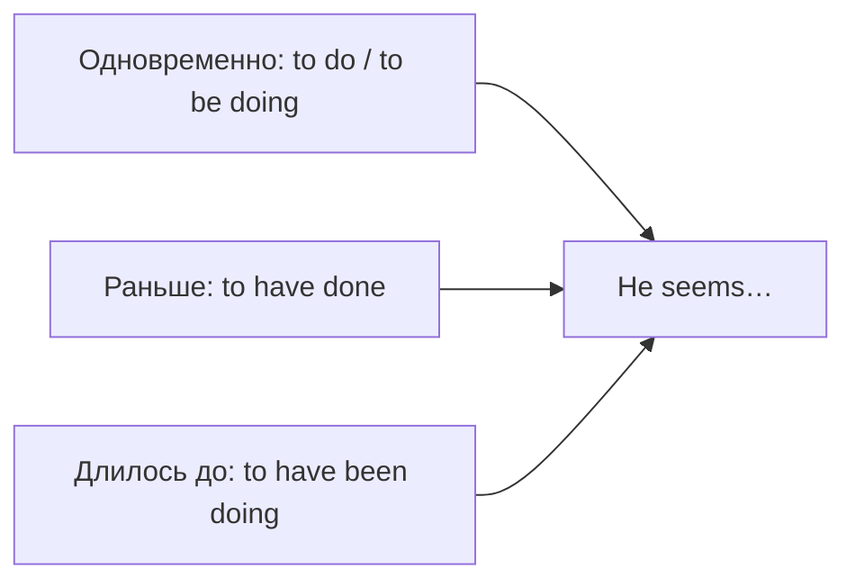

# Инфинитив и герундий C1 — to have done, his coming, it's no use

> [!abstract] Коротко
> - Формы инфинитива: `to do` · `to be doing` (процесс) · `to have done` (раньше) · `to have been doing` (длилось до) · `to be done` (пассив).
> - Герундий со своим «исполнителем»: `I don't mind him/his coming` (формально `his`).
> - Устойчивые модели с `-ing`: `It's no use / no good`, `There's no point (in)`, `It's worth`, `can't help`, `have difficulty (in)`, `be/get used to`, `object to`, `be committed to`.

<!-- beginner-intro:start -->
## Простыми словами

Инфинитив умеет показывать время и залог так же, как обычный глагол. Сравни: `He seems to be happy` — кажется, он счастлив **сейчас**; `He seems to have been happy` — кажется, он **был** счастлив; `He seems to be working` — кажется, он **сейчас работает**. Выбор формы зависит от того, когда происходит действие относительно главного глагола.

Герундий тоже может иметь своего «исполнителя». `I don't like him smoking` — мне не нравится, что **он** курит. В официальном стиле вместо `him` ставят притяжательное `his`: `I appreciate your helping me`. И наконец, есть ряд устойчивых выражений, после которых всегда идёт `-ing` — их проще выучить целиком.

### Наглядная схема

Формы инфинитива по времени относительно главного глагола:

## Правило и схема
<!-- beginner-intro:end -->

| Форма | Смысл | Пример |
| --- | --- | --- |
| to + V | одновременно / позже | She seems **to know** him. |
| to be + V-ing | процесс в этот момент | He appears **to be sleeping**. |
| to have + V3 | раньше главного действия | I'm sorry **to have kept** you waiting. |
| to have been + V-ing | длительный процесс до | They seem **to have been arguing**. |
| to be + V3 | пассив | It needs **to be checked**. |
| to have been + V3 | пассив, раньше | He's said **to have been arrested**. |
| would like / love / prefer + to have V3 | несбывшееся желание в прошлом | I **would like to have seen** it. |
| was / were + to have V3 | план не осуществился | We **were to have met** at six. |

| Герундий | Пример |
| --- | --- |
| (кого/чей) + V-ing | Do you mind **me/my opening** the window? |
| having + V3 | He denied **having taken** it. |
| being + V3 | I hate **being kept** waiting. |
| It's no use / no good + V-ing | **It's no use crying**. |
| There's no point (in) + V-ing | **There's no point (in) arguing**. |
| be worth + V-ing | The film **is worth seeing**. |
| can't help / can't stand / can't bear + V-ing | I **can't help thinking**… |
| have difficulty / trouble (in) + V-ing | I **had trouble finding** it. |
| spend / waste + время + V-ing | She **spent hours trying** to fix it. |
| to (предлог) + V-ing | object to / be committed to / when it comes to + **V-ing** |

**Подлежащее-инфинитив** звучит книжно, поэтому обычно используют `it`: `It is important to listen` вместо `To listen is important`. Герундий-подлежащее естественен: `Listening is a skill`.

<!-- beginner-examples:start -->
## Примеры с разбором

1. **She seems to have lost weight.** — Похоже, она похудела.  
   **Разбор:** «кажется» сейчас, а похудела раньше → `to have lost`.
2. **I'd love to have been there.** — Как бы мне хотелось там побывать!  
   **Разбор:** `would love + to have V3` — сожаление о несбывшемся в прошлом.
3. **I object to being treated like a child.** — Я против того, чтобы со мной обращались как с ребёнком.  
   **Разбор:** `to` в `object to` — предлог, поэтому `-ing`; со мной обращаются → пассив `being treated`.
4. **There's no point in complaining — nobody will listen.** — Жаловаться бессмысленно, никто не послушает.  
   **Разбор:** устойчивая модель `There's no point (in) + V-ing`.
<!-- beginner-examples:end -->

## Дополнительные примеры

- **He pretended to be reading.** — Он делал вид, что читает.
- **I appreciate your coming at such short notice.** — Благодарю, что пришли, хотя предупредили вас в последний момент.
- **When it comes to cooking, he's a genius.** — Что касается готовки, тут он гений.

> [!warning] Частая ошибка
> После предлога `to` — **-ing**: **I look forward to hearing**, **I'm committed to improving**, **with a view to buying**. Не *to hear*, *to improve*, *to buy*.

## Проверь себя

Сначала ответь сам, потом открой ответы: нажми на заголовок блока.

1. Вставь форму: I'm sorry ___ (disturb) you yesterday.
2. Вставь форму: They seem ___ (wait) for hours — they look exhausted.
3. Вставь форму: This museum is worth ___ (visit).
4. Вставь форму: I'm not used to ___ (tell) what to do.
5. Перефразируй: *It's useless to argue with him.* (no use)
6. Исправь ошибку: *I look forward to meet you.*

> [!success]- Ответы и пояснения
> 1. **to have disturbed** — действие раньше, чем извинение.
> 2. **to have been waiting** — длительный процесс до сейчас.
> 3. **visiting** — `be worth + V-ing`.
> 4. **being told** — после предлога `to`; пассив, мне говорят.
> 5. **It's no use arguing with him.** — `It's no use + V-ing`.
> 6. **I look forward to meeting you.** — `to` здесь предлог.

## Источники

- [Cambridge Dictionary — Perfect infinitive with to](https://dictionary.cambridge.org/grammar/british-grammar/perfect-infinitive-with-to-to-have-worked)
- [Cambridge Dictionary — Infinitive: active or passive](https://dictionary.cambridge.org/grammar/british-grammar/infinitive-active-or-passive)
- [Cambridge Dictionary — Verb patterns: verb + infinitive or verb + -ing?](https://dictionary.cambridge.org/grammar/british-grammar/verb-patterns-verb-infinitive-or-verb-ing)
- [Cambridge Dictionary — Be worth doing something](https://dictionary.cambridge.org/grammar/british-grammar/word-patterns-be-worth-doing-something)

---

[[140 - Продвинутые сравнения — twice as, nowhere near, by far|← Предыдущая тема]] · [[000 - Оглавление|Оглавление]] · [[142 - Номинализация и академический стиль|Следующая тема →]]
