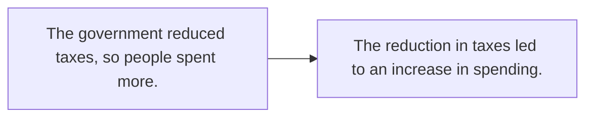

# Номинализация и академический стиль

> [!abstract] Коротко
> - **Номинализация** — превращение действия в существительное: `Prices increased sharply` → `There was a sharp increase in prices`.
> - Академический и деловой стиль любит существительные, безличные конструкции и пассив: `It has been argued that…`, `There is evidence that…`
> - Типичные пары: `decide → decision`, `fail → failure`, `grow → growth`, `analyse → analysis`, `important → importance`, `able → ability`.

<!-- beginner-intro:start -->
## Простыми словами

В разговоре мы рассказываем через глаголы: «Мы решили закрыть магазин, потому что продажи упали». В отчёте, эссе или научной статье то же самое звучит через существительные: «Решение о закрытии магазина было вызвано падением продаж» — `The decision to close the shop was caused by a fall in sales`. Это и есть **номинализация**.

Зачем она нужна? Существительные позволяют упаковать много информации в одну фразу, сделать текст объективнее (нет «я», «мы») и удобнее связывать идеи. Но в меру: перегруженный существительными текст становится тяжёлым. На уровне C1 важно уметь переключаться между разговорным «глагольным» и письменным «именным» стилем.

### Наглядная схема

## Правило и схема
<!-- beginner-intro:end -->

**Как превращать:**

| Разговорно (глагол / прилагательное) | Академично (существительное) |
| --- | --- |
| Prices **rose** sharply. | There was a sharp **rise in** prices. |
| The company **failed** because… | The company's **failure** was due to… |
| They **analysed** the data carefully. | A careful **analysis of** the data… |
| People are **aware** of the problem. | There is (growing) **awareness of** the problem. |
| How **important** is education? | the **importance of** education |
| We **developed** new methods. | the **development of** new methods |

**Помогающие модели:**
- глагол-связка + существительное: `make a decision`, `carry out research`, `have an impact on`, `lead to / result in / be due to`;
- предлоги при существительных: `increase/rise/fall/decline **in**`, `impact/effect/influence **on**`, `cause **of**`, `reason **for**`, `solution **to**`, `demand **for**`;
- безличные рамки: `It is widely believed that…`, `It can be argued that…`, `There is little evidence that…`, `It should be noted that…`;
- пассив вместо «мы/я»: `The data **were collected** in 2024`.

**Суффиксы:** `-tion/-sion` (decide → decision), `-ment` (develop → development), `-ance/-ence` (perform → performance, exist → existence), `-ity` (able → ability), `-ness` (aware → awareness), `-al` (arrive → arrival, refuse → refusal), `-ure` (fail → failure), `-th` (grow → growth, strong → strength).

<!-- beginner-examples:start -->
## Примеры с разбором

1. **Unemployment rose, which caused crime to increase. → The rise in unemployment led to an increase in crime.** — Рост безработицы привёл к росту преступности.  
   **Разбор:** два глагола стали существительными (`rise`, `increase`), связь выражена глаголом `led to`.
2. **We need to protect the environment urgently. → The protection of the environment is an urgent need.** — Защита окружающей среды — насущная необходимость.  
   **Разбор:** `protect → protection`, `urgently → urgent` (наречие стало прилагательным при существительном).
3. **It is widely accepted that exercise improves mood.** — Общепризнано, что физическая активность улучшает настроение.  
   **Разбор:** безличная рамка убирает конкретного автора мнения.
4. **The researchers carried out a detailed analysis of the results.** — Исследователи провели подробный анализ результатов.  
   **Разбор:** `analysed in detail` → `carried out a detailed analysis of`.
<!-- beginner-examples:end -->

## Дополнительные примеры

- **There has been a significant decline in the number of smokers.** — Число курильщиков значительно сократилось.
- **The cause of the delay remains unclear.** — Причина задержки остаётся неясной.
- **Failure to comply will result in a fine.** — Невыполнение требований повлечёт штраф.

> [!warning] Частая ошибка
> Предлог при существительном: **an increase in prices** (в чём выросло), а не *of prices*; **an increase of 5%** — на сколько. **The effect on**, а не *the effect to*.

## Проверь себя

Сначала ответь сам, потом открой ответы: нажми на заголовок блока.

1. Номинализируй: *The population grew rapidly.* → There was ___
2. Номинализируй: *They decided to close the factory.* → The ___
3. Номинализируй: *Sales fell, so the company lost money.* (led to)
4. Образуй существительное: *responsible* → ___
5. Вставь предлог: There has been a sharp rise ___ the cost of living.
6. Сделай безличным: *Many people believe that the climate is changing.*

> [!success]- Ответы и пояснения
> 1. **There was rapid growth in the population. / There was a rapid growth of the population.** — `grow → growth`.
> 2. **The decision to close the factory…** — `decide → decision` + `to V`.
> 3. **The fall in sales led to financial losses for the company.** — два действия → существительные + связующий глагол.
> 4. **responsibility** — суффикс `-ity`.
> 5. **in** — `rise in` + то, что выросло.
> 6. **It is widely believed that the climate is changing.** — безличная пассивная рамка.

## Источники

- [Cambridge Dictionary — Nouns: forming nouns from other words](https://dictionary.cambridge.org/grammar/british-grammar/nouns-forming-nouns-from-other-words)
- [Cambridge Dictionary — Noun phrases](https://dictionary.cambridge.org/grammar/british-grammar/noun-phrases)
- [Cambridge Dictionary — Detached impersonal style](https://dictionary.cambridge.org/grammar/british-grammar/detached-impersonal-style)

---

[[141 - Инфинитив и герундий C1 — to have done, his coming, it's no use|← Предыдущая тема]] · [[000 - Оглавление|Оглавление]] · [[143 - Смягчение высказываний — seem, tend to, arguably|Следующая тема →]]
