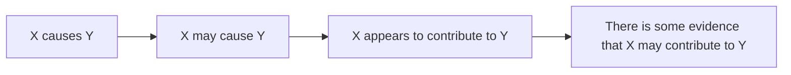

# Смягчение высказываний — seem, tend to, arguably

> [!abstract] Коротко
> - **Hedging** — смягчение категоричности: вместо `This is wrong` → `This seems to be somewhat misleading`.
> - Средства: `seem / appear to`, `tend to`, `may / might / could`, `likely / possibly / arguably / apparently`, `to some extent`, `It would appear that…`, `There is some evidence that…`
> - В разговоре: `sort of`, `kind of`, `a bit`, `I'd say`, `I suppose`, `just`.

<!-- beginner-intro:start -->
## Простыми словами

Сравни: «Это неправда» и «Похоже, это не совсем так». Вторая фраза мягче и осторожнее. В английской культуре общения, особенно британской, а также в академическом письме такая осторожность очень ценится. Категоричное `This theory is wrong` звучит грубо и самоуверенно. `This theory may not fully explain…` — вежливо и научно.

Смягчение — не «неуверенность», а **точность и вежливость**. Учёный не знает всего наверняка, поэтому пишет `The results suggest that…` («результаты позволяют предположить»), а не `The results prove…`. В разговоре мы смягчаем критику и несогласие: `I'm not sure that's quite right` вместо `You're wrong`.

### Наглядная схема

## Правило и схема
<!-- beginner-intro:end -->

| Средство | Примеры |
| --- | --- |
| Глаголы-смягчители | seem, appear, tend, suggest, indicate, assume |
| Модальные | may, might, could, would |
| Наречия | possibly, probably, apparently, arguably, presumably, relatively, somewhat, generally |
| Прилагательные | likely, possible, probable, apparent |
| Количество/частота | some, many, most, often, in most cases, to some extent, to a certain degree |
| Безличные рамки | It seems that… / It would appear that… / It is possible that… / There is some evidence that… |
| Вводные | In my view… / As far as I know… / It could be argued that… |
| Разговорные | sort of, kind of, a bit, a little, I'd say, I suppose, just, quite |

Модели с `seem/appear`:
- `S + seem/appear + to V`: `He seems to know` (кажется, он знает);
- `It seems/appears (that) + предложение`: `It seems (that) he knows`;
- о прошлом: `seem + to have V3`: `She seems to have left`;
- отрицание: `He doesn't seem to understand` (чаще, чем *seems not to*).

`Tend to + V` — «обычно, как правило»: `People tend to overestimate their abilities`.

<!-- beginner-examples:start -->
## Примеры с разбором

1. **This approach seems to be more effective.** — Этот подход, по-видимому, эффективнее.  
   **Разбор:** `seems to be` вместо категоричного `is`.
2. **The data suggest that stress may contribute to the illness.** — Данные указывают на то, что стресс может способствовать болезни.  
   **Разбор:** два смягчителя: `suggest` вместо `prove`, `may` вместо `does`.
3. **Young people tend to spend more time online.** — Молодые люди, как правило, проводят больше времени в интернете.  
   **Разбор:** `tend to` ограничивает обобщение: «обычно, не всегда».
4. **It could be argued that the policy has failed.** — Можно утверждать, что эта политика провалилась.  
   **Разбор:** безличная рамка позволяет высказать спорную позицию осторожно.
<!-- beginner-examples:end -->

## Дополнительные примеры

- **Apparently, the meeting has been cancelled.** — Говорят, совещание отменили.
- **It's arguably the best film of the decade.** — Это, пожалуй, лучший фильм десятилетия.
- **I'd say it's a bit too expensive.** — Я бы сказал, это дороговато.

> [!warning] Частая ошибка
> Не перебарщивай: *It might possibly perhaps seem…* — слишком много смягчителей подряд звучит неуверенно. Одного-двух достаточно. `Apparently` = «судя по всему, говорят», а не «очевидно» (это `obviously`).

## Проверь себя

Сначала ответь сам, потом открой ответы: нажми на заголовок блока.

1. Смягчи с seem: *He is unhappy.*
2. Смягчи с tend: *Women live longer than men.*
3. Смягчи: *This proves that the theory is wrong.* (suggest, may)
4. Смягчи с it would appear: *The project has failed.*
5. Перефразируй: *It seems that she has forgotten.* → She ___
6. Исправь ошибку: *He seems not understand the question.*

> [!success]- Ответы и пояснения
> 1. **He seems (to be) unhappy.** — `seem` смягчает.
> 2. **Women tend to live longer than men.** — `tend to` — тенденция.
> 3. **This suggests that the theory may be wrong.** — `suggest` + `may`.
> 4. **It would appear that the project has failed.** — очень осторожная безличная рамка.
> 5. **She seems to have forgotten.** — о прошлом → `to have V3`.
> 6. **He doesn't seem to understand the question.** — естественное отрицание `doesn't seem to`.

## Источники

- [Cambridge Dictionary — Hedges](https://dictionary.cambridge.org/grammar/british-grammar/hedges-just)
- [Cambridge Dictionary — Seem](https://dictionary.cambridge.org/grammar/british-grammar/seem)
- [Cambridge Dictionary — Appear](https://dictionary.cambridge.org/grammar/british-grammar/appear)
- [Cambridge Dictionary — Vague expressions](https://dictionary.cambridge.org/grammar/british-grammar/vague-expressions)

---

[[142 - Номинализация и академический стиль|← Предыдущая тема]] · [[000 - Оглавление|Оглавление]] · [[144 - Дискурсивные маркеры — that said, mind you, admittedly|Следующая тема →]]
