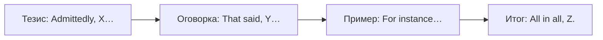

# Дискурсивные маркеры — that said, mind you, admittedly

> [!abstract] Коротко
> - Маркеры показывают **ход мысли**: уступку (`admittedly, granted`), оговорку (`that said, mind you, even so`), смену темы (`as for, as regards, by the way`), итог (`all in all, in short`), уточнение (`in other words, that is to say`).
> - В речи: `Well, Actually, Anyway, I mean, You know, Right, So`.
> - На письме обычно отделяются запятой; не начинай ими каждое предложение.

<!-- beginner-intro:start -->
## Простыми словами

Дискурсивные маркеры — «дорожные знаки» текста. Они не меняют смысл отдельной фразы, но показывают слушателю, **куда поворачивает мысль**: сейчас будет уступка, возражение, новая тема или вывод. Сравни: `The hotel was expensive. The food was excellent.` и `The hotel was expensive. That said, the food was excellent.` Во втором варианте сразу понятно: «при всём при этом».

На уровне B1–B2 ты используешь `however, moreover, so`. На C1 набор становится тоньше. Например, `admittedly` — «надо признать» (уступаешь оппоненту), `mind you` — разговорное «правда, впрочем», `as for…` — «что касается…». Правильные маркеры делают речь связной и «взрослой».

### Наглядная схема

Типичная аргументация с маркерами:

## Правило и схема
<!-- beginner-intro:end -->

| Функция | Письменные / нейтральные | Разговорные |
| --- | --- | --- |
| Уступка | admittedly, granted, of course, it is true that | fair enough, I know, sure |
| Оговорка, контраст | that said, having said that, even so, nonetheless, all the same | mind you, still, though (в конце) |
| Противоречие ожиданию | in fact, as a matter of fact, on the contrary | actually, to be honest |
| Новая тема / переход | as for, as regards, with regard to, turning to | by the way, anyway, right, so |
| Уточнение | in other words, that is (to say), namely | I mean |
| Пример | for instance, for example, such as | like (разг.), say |
| Усиление, «более того» | moreover, furthermore, what is more | besides, on top of that |
| Обобщение, итог | all in all, in short, on the whole, to sum up, overall | basically, at the end of the day |
| Возврат к главному | anyway, at any rate, in any case | anyway, so |
| Подтверждение очевидного | after all, clearly, naturally | you know, obviously |

**Пунктуация:** в начале предложения — запятая после маркера: `That said, …`. `However` между двумя предложениями — с точкой или точкой с запятой: `It was late; however, we continued.`

**After all** = «в конце концов, ведь» (объяснение), а не «наконец» (это `finally / in the end`).

<!-- beginner-examples:start -->
## Примеры с разбором

1. **Admittedly, the plan is risky. However, the potential benefits are huge.** — Надо признать, план рискованный. Однако потенциальная выгода огромна.  
   **Разбор:** `admittedly` уступает контраргументу, `however` возвращает к позиции автора.
2. **The flat is small. That said, it's in a great location.** — Квартира маленькая. Но при этом в отличном месте.  
   **Разбор:** `that said` = «при всём при этом», вводит оговорку к предыдущему.
3. **He's a great player. Mind you, he's getting a bit old.** — Он отличный игрок. Правда, уже немного староват.  
   **Разбор:** `mind you` — разговорная оговорка, смягчающая предыдущую мысль.
4. **As for the budget, we'll discuss it next week.** — Что касается бюджета, обсудим его на следующей неделе.  
   **Разбор:** `as for` переводит разговор к новой, связанной теме.
<!-- beginner-examples:end -->

## Дополнительные примеры

- **Don't be so hard on him — after all, he's only a child.** — Не будь к нему так строг, в конце концов, он всего лишь ребёнок.
- **All in all, it was a successful year.** — В целом год был успешным.
- **I didn't enjoy it. In fact, I left early.** — Мне не понравилось. Более того, я ушёл раньше.

> [!warning] Частая ошибка
> **After all** ≠ «наконец, после всего»: для этого **finally / in the end / eventually**. **Actually** ≠ «актуально»: это «на самом деле». **On the contrary** — «напротив» (возражение), а не **on the other hand** — «с другой стороны» (сравнение).

## Проверь себя

Сначала ответь сам, потом открой ответы: нажми на заголовок блока.

1. Вставь: The film was too long. ___, the acting was superb. (при этом)
2. Вставь: Don't worry about the mistake. ___, everyone makes them. (в конце концов, ведь)
3. Вставь: ___ the kids, they can stay with Grandma. (что касается)
4. Вставь: — You must be tired. — ___, I feel great. (напротив)
5. Вставь: ___, there are some advantages, but the disadvantages outweigh them. (надо признать)
6. Исправь ошибку: *We waited for hours and after all the bus came.*

> [!success]- Ответы и пояснения
> 1. **That said / Having said that / Even so** — оговорка к предыдущему.
> 2. **After all** — объяснение «ведь».
> 3. **As for** — переход к теме.
> 4. **On the contrary** — возражение на утверждение.
> 5. **Admittedly / Granted** — уступка.
> 6. **…and in the end / eventually the bus came.** — «наконец» — не `after all`.

## Источники

- [Cambridge Dictionary — Discourse markers (so, right, okay)](https://dictionary.cambridge.org/grammar/british-grammar/discourse-markers-so-right-okay)
- [Cambridge Dictionary — Adverbs as discourse markers](https://dictionary.cambridge.org/grammar/british-grammar/adverbs-as-discourse-markers-anyway-finally)
- [Cambridge Dictionary — Conjunctions and linking words](https://dictionary.cambridge.org/grammar/british-grammar/conjunctions-and-linking-words)

---

[[143 - Смягчение высказываний — seem, tend to, arguably|← Предыдущая тема]] · [[000 - Оглавление|Оглавление]]
