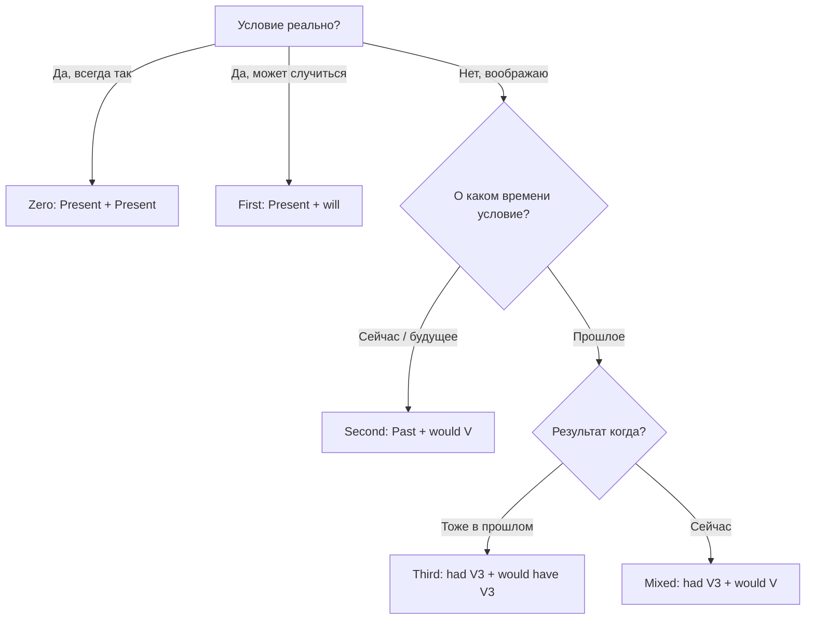

---
tags:
  - english/grammar
  - english/reference
---

# Справочник — Все типы условных предложений

> [!abstract] Как пользоваться
> Спроси себя: **насколько реально условие** и **к какому времени** оно относится. Реальное → в части с `if` настоящее время. Нереальное → форма «сдвигается назад» (Past или Past Perfect), а в результате появляется `would`.

## Сводная таблица

| Тип | Ситуация | Условие (if-часть) | Результат | Пример |
| --- | --- | --- | --- | --- |
| **Zero** | всегда так бывает | Present Simple | Present Simple | If you heat ice, it **melts**. |
| **First** | реальное будущее | Present Simple | will + V | If it **rains**, we**'ll stay** home. |
| **Second** | воображаемое сейчас / маловероятное будущее | Past Simple | would + V | If I **had** a car, I**'d drive**. |
| **Third** | другое прошлое (уже не изменить) | had + V3 | would have + V3 | If I**'d known**, I**'d have come**. |
| **Mixed 1** | прошлое → результат сейчас | had + V3 | would + V | If I**'d studied**, I**'d be** a doctor now. |
| **Mixed 2** | постоянная черта → прошлое | Past Simple | would have + V3 | If I **spoke** French, I**'d have understood**. |

Подробные темы: [[059 - Zero Conditional — общие закономерности|Zero]] · [[060 - First Conditional — реальное будущее условие|First]] · [[061 - Second Conditional — воображаемое настоящее и будущее|Second]] · [[062 - Third Conditional — другое прошлое|Third]] · [[063 - Mixed Conditionals — разные времена условия и результата|Mixed]].

## Как выбрать тип

## Вместо if

| Слово | Значение | Пример | Тема |
| --- | --- | --- | --- |
| unless | если не | Unless you hurry, you'll be late. | [[064 - Unless, provided, as long as и in case\|Unless, in case]] |
| as long as / provided (that) | при условии | You can go as long as you're back by ten. | [[064 - Unless, provided, as long as и in case\|Unless, in case]] |
| in case | на всякий случай | Take a coat in case it gets cold. | [[064 - Unless, provided, as long as и in case\|Unless, in case]] |
| even if | даже если | I'll go even if it rains. | [[064 - Unless, provided, as long as и in case\|Unless, in case]] |
| Had I / Were I / Should you | формальная инверсия | Had I known, I'd have helped. | [[129 - Условия без if — Had I known, but for, supposing\|Условия без if]] |
| but for / if it weren't for | если бы не | But for your help, I'd have failed. | [[129 - Условия без if — Had I known, but for, supposing\|Условия без if]] |
| supposing / what if | а что если | What if it doesn't work? | [[129 - Условия без if — Had I known, but for, supposing\|Условия без if]] |
| otherwise | иначе | Hurry, otherwise we'll miss it. | [[129 - Условия без if — Had I known, but for, supposing\|Условия без if]] |

## Родственные «нереальные» конструкции

| Конструкция | Сейчас | О прошлом |
| --- | --- | --- |
| I wish / If only | I wish I **knew**. | I wish I **had known**. |
| I'd rather (you) | I'd rather you **stayed**. | I'd rather you **hadn't told** her. |
| It's time | It's time we **left**. | — |
| as if / as though | He acts as if he **were** the boss. | He looked as if he **had seen** a ghost. |

Подробно: [[065 - Wish и if only — желания и сожаления|Wish и if only]], [[058 - Prefer и would rather — предпочтения|Would rather]], [[066 - It's time — пора сделать|It's time]].

> [!warning] Главное правило
> В части с `if` **не ставь `will` и `would`**: **If it rains**, не *If it will rain*; **If I had**, не *If I would have*.

---

[[000 - Оглавление|← Оглавление]]
