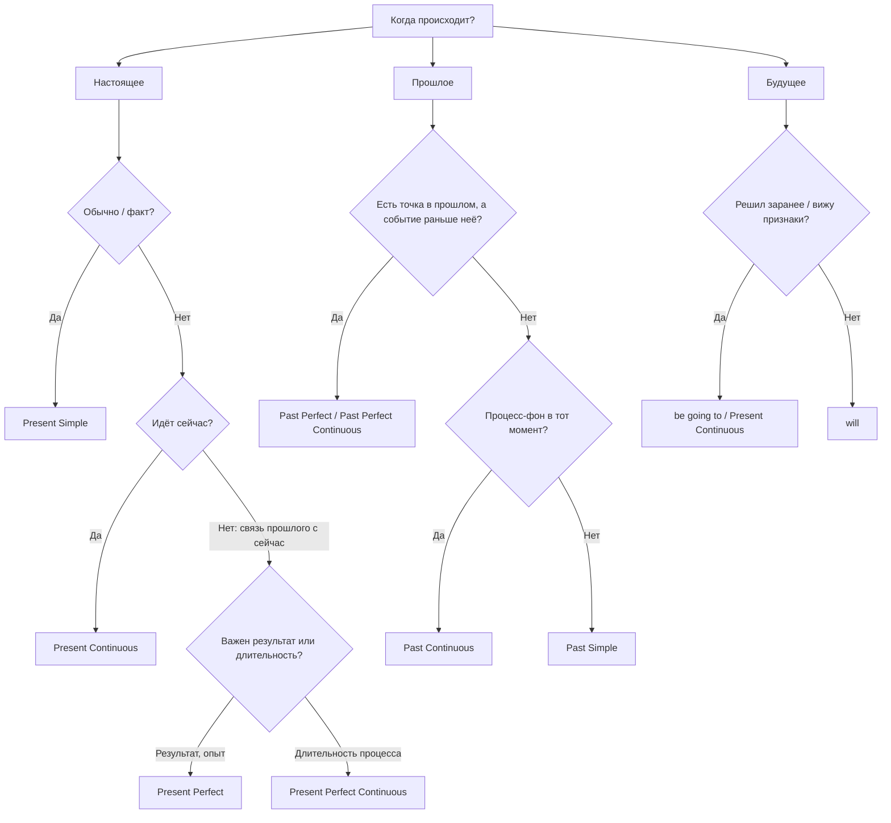

---
tags:
  - english/grammar
  - english/reference
---

# Справочник — Карта всех времён

> [!abstract] Как пользоваться
> Это шпаргалка, а не учебник. Если форма или смысл непонятны, перейди по ссылке в подробную тему. Строй любое время по двум вопросам: **КОГДА?** (настоящее / прошлое / будущее) и **КАК?** (Simple — факт целиком, Continuous — процесс, Perfect — результат к моменту, Perfect Continuous — длительность к моменту).

## 12 времён в одной таблице

| | **Simple** — факт | **Continuous** — процесс | **Perfect** — результат к моменту | **Perfect Continuous** — длительность к моменту |
| --- | --- | --- | --- | --- |
| **Present** | I **work** / she **works** | I **am working** | I **have worked** | I **have been working** |
| **Past** | I **worked** | I **was working** | I **had worked** | I **had been working** |
| **Future** | I **will work** | I **will be working** | I **will have worked** | I **will have been working** |

Формулы «по кубикам»: **Continuous** = `be + V-ing`; **Perfect** = `have + V3`; **Perfect Continuous** = `have + been + V-ing`. Время показывает **первый** помощник (`am/was/will be`, `have/had/will have`).

## Когда что использовать

| Время | Главная идея | Пример | Подробно |
| --- | --- | --- | --- |
| Present Simple | привычка, факт, расписание | I **get up** at 7. The train **leaves** at 9. | [[022 - Present Simple — привычки и факты\|Present Simple]] |
| Present Continuous | сейчас, временно, договорённость | I**'m reading**. I**'m meeting** Tom tonight. | [[025 - Present Continuous — процесс сейчас\|Present Continuous]] |
| Present Perfect | опыт, результат сейчас, незаконченный период | I**'ve lost** my key. **Have** you **been** to Rome? | [[033 - Present Perfect — связь прошлого с настоящим\|Present Perfect]] |
| Present Perfect Continuous | как долго длится до сейчас | I**'ve been waiting** for an hour. | [[037 - Present Perfect Continuous — длительность и процесс\|Present Perfect Continuous]] |
| Past Simple | законченное прошлое | I **saw** her yesterday. | [[028 - Past Simple — завершённое прошлое\|Past Simple]] |
| Past Continuous | процесс в момент прошлого, фон | I **was cooking** when she called. | [[030 - Past Continuous и Past Simple — фон и событие\|Past Continuous]] |
| Past Perfect | раньше другого прошлого | The film **had started** when we arrived. | [[038 - Past Perfect — раньше другого прошлого\|Past Perfect]] |
| Past Perfect Continuous | как долго длилось до момента в прошлом | I**'d been waiting** for an hour when he came. | [[039 - Past Perfect Continuous — процесс до прошлого момента\|Past Perfect Continuous]] |
| Future Simple (will) | решение сейчас, обещание, прогноз | I**'ll help** you. | [[041 - Will — решения, обещания и прогнозы\|Will]] |
| be going to | намерение, прогноз по признакам | I**'m going to** buy a car. | [[042 - Be going to — намерения и видимые признаки\|Be going to]] |
| Future Continuous | процесс в момент будущего | This time tomorrow I**'ll be flying**. | [[045 - Future Continuous — процесс в будущем\|Future Continuous]] |
| Future Perfect | готово к сроку | I**'ll have finished** by six. | [[046 - Future Perfect — к будущему сроку\|Future Perfect]] |
| Future Perfect Continuous | как долго будет длиться к моменту | By June I**'ll have been working** here a year. | [[047 - Future Perfect Continuous — длительность к будущему моменту\|Future Perfect Continuous]] |

## Как выбрать время: дерево решений

## Слова-подсказки

| Подсказка | Обычно время |
| --- | --- |
| always, usually, often, every day, on Mondays | Present Simple |
| now, at the moment, Look!, Listen!, this week | Present Continuous |
| ever, never, just, already, yet, so far, recently, since, for (до сейчас) | Present Perfect (Continuous) |
| yesterday, last…, … ago, in 2010, when I was… | Past Simple |
| while, at 8 o'clock yesterday, when + событие | Past Continuous |
| before, after, by the time, already (в прошлом) | Past Perfect |
| tomorrow, next…, soon, I think, probably | will / going to |
| this time tomorrow, at 8 tomorrow | Future Continuous |
| by + будущий срок, by the time | Future Perfect |

Подсказки помогают, но решает **смысл**. Например, `today` может требовать и Present Perfect, и Past Simple: [[034 - Present Perfect или Past Simple|Present Perfect или Past Simple]].

## Пассив во всех временах

Формула: `be` в нужном времени + `V3`.

| Время | Актив | Пассив |
| --- | --- | --- |
| Present Simple | They **clean** the room. | The room **is cleaned**. |
| Present Continuous | They **are cleaning** it. | It **is being cleaned**. |
| Present Perfect | They **have cleaned** it. | It **has been cleaned**. |
| Past Simple | They **cleaned** it. | It **was cleaned**. |
| Past Continuous | They **were cleaning** it. | It **was being cleaned**. |
| Past Perfect | They **had cleaned** it. | It **had been cleaned**. |
| Future | They **will clean** it. | It **will be cleaned**. |
| Future Perfect | They **will have cleaned** it. | It **will have been cleaned**. |
| Модальный | They **must clean** it. | It **must be cleaned**. |

Подробно: [[067 - Passive Voice — основа пассивного залога|Passive Voice — основа]], [[068 - Passive Voice во временах и с модальными глаголами|Passive Voice во временах]].

## Вопросы и отрицания — одно правило для всех

1. Найди **первый помощник** (`am/is/are, was/were, have/has/had, will, can…`).
2. Вопрос: поставь его **перед** подлежащим. Отрицание: добавь `not` **после** него.
3. Нет помощника (Present/Past Simple)? Возьми `do/does/did`, а глагол верни в начальную форму.

| Утверждение | Вопрос | Отрицание |
| --- | --- | --- |
| She **is** working. | **Is** she working? | She **isn't** working. |
| They **have** left. | **Have** they left? | They **haven't** left. |
| He **will have** finished. | **Will** he have finished? | He **won't** have finished. |
| She **works**. | **Does** she work? | She **doesn't** work. |
| They **left**. | **Did** they leave? | They **didn't** leave. |

---

[[000 - Оглавление|← Оглавление]]
