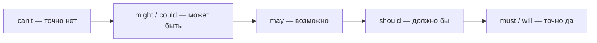

---
tags:
  - english/grammar
  - english/reference
---

# Справочник — Карта модальных глаголов

> [!abstract] Как пользоваться
> - Модальные глаголы (`can, could, may, might, must, shall, should, will, would`) — особые помощники: **без -s**, **без to** после них, вопрос и отрицание — **без do**: `She can swim. Can she swim? She can't swim.`
> - Один глагол имеет несколько значений. Ищи по **смыслу**, который хочешь выразить.
> - О прошлом: `modal + have + V3` (`must have gone`, `should have told`).

## По смыслу

| Хочу сказать… | Настоящее / будущее | Прошлое | Подробно |
| --- | --- | --- | --- |
| умею, могу | can, be able to | could (вообще), was able to / managed to (в конкретном случае) | [[050 - Способность — can, could, be able to\|Способность]] |
| можно мне? | Can / Could / May I…? | was allowed to | [[051 - Разрешение и вежливые просьбы\|Разрешение и просьбы]] |
| сделай, пожалуйста | Can / Could / Would you…? Would you mind + V-ing? | — | [[051 - Разрешение и вежливые просьбы\|Разрешение и просьбы]] |
| должен, нужно | must, have to, need to | had to | [[052 - Обязанность — must, have to, need to\|Обязанность]] |
| нельзя | mustn't, can't, not allowed to | wasn't allowed to, couldn't | [[053 - Запрет и отсутствие необходимости\|Запрет]] |
| не обязательно | don't have to, needn't, don't need to | didn't have to; needn't have done (сделал зря) | [[053 - Запрет и отсутствие необходимости\|Запрет и необязательность]] |
| стоит, советую | should, ought to, had better | should have done (жаль, что не) | [[054 - Совет — should, ought to, had better\|Совет]] |
| наверняка (догадка) | must, will | must have done, will have done | [[055 - Возможность и выводы о настоящем\|Выводы о настоящем]] |
| наверняка нет | can't, couldn't | can't have done, couldn't have done | [[056 - Выводы о прошлом — must have done\|Выводы о прошлом]] |
| возможно | may, might, could | may / might / could have done | [[055 - Возможность и выводы о настоящем\|Возможность]] |
| вероятно (ожидаемо) | should, ought to, be likely to | should have done | [[044 - Вероятность будущего — likely и probably\|Вероятность]] |
| мог бы, но не сделал | — | could have done | [[057 - Модальные формы о несделанном и лишнем\|О несделанном]] |
| будущее, обещание | will, shall (I/we) | would (будущее в прошлом) | [[041 - Will — решения, обещания и прогнозы\|Will]] |
| предложение | Shall I / we…? Would you like…? | — | [[041 - Will — решения, обещания и прогнозы\|Will]] |
| привычка | will (характер) | would, used to | [[031 - Used to и would — прошлые привычки\|Used to и would]] |
| воображаемое | would, could, might | would have, could have | [[061 - Second Conditional — воображаемое настоящее и будущее\|Second Conditional]] |

## Шкала уверенности

## Три главные ловушки

| Ловушка | Правильно |
| --- | --- |
| `mustn't` ≠ «не обязательно» | `You mustn't` — нельзя; `You don't have to` — не обязательно |
| у `must` нет прошлого | «пришлось» = `had to`; `must have done` = «наверное, сделал» |
| два модальных подряд нельзя | `will be able to`, `might have to`, а не *will can*, *might must* |

Продвинутые значения (`That'll be the postman`, `might as well`, `be bound to`): [[131 - Модальные глаголы C1 — will для догадок, may well, be bound to|Модальные глаголы C1]].

## Источники

- [Cambridge Dictionary — Modality: meanings and uses](https://dictionary.cambridge.org/grammar/british-grammar/modality-meanings-and-uses)
- [Cambridge Dictionary — Modality: forms](https://dictionary.cambridge.org/grammar/british-grammar/modality-forms)

---

[[000 - Оглавление|← Оглавление]]
